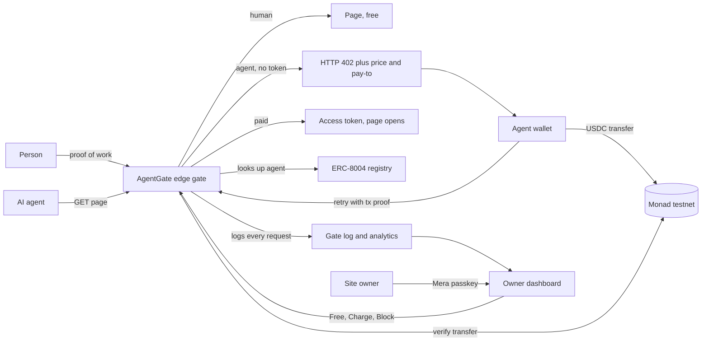
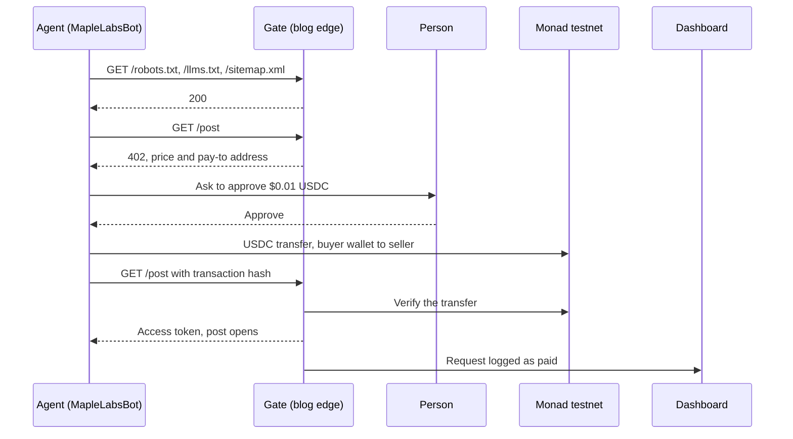
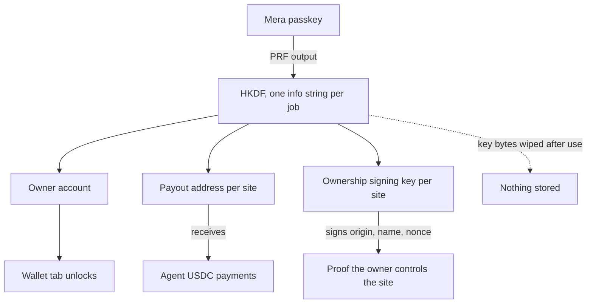

# AgentGate

AgentGate lets a site owner charge AI agents for reading their content, instead of hoping they honor `robots.txt`.
An unpaid agent gets an HTTP 402 with a price. A paying agent gets the page and a receipt. The owner sees who read
what, what they paid, and what was blocked.

Payments settle in **USDC on Monad testnet**. Agent identity comes from the ERC-8004 identity registry on Monad.

- Dashboard: https://agentgate.santboblabs.com
- Crawl Sandbox (demo bot): https://bot.agentgate.santboblabs.com

## The problem

AI agents now read the open web at scale. A site owner has two options today, and both are bad:

1. **Block them in `robots.txt`.** It is a request, not a lock. Nothing enforces it, and owners cannot even see which agents ignored it.
2. **Let them read for free.** The owner pays the hosting bill and gets no revenue and no record of who took what.

Existing 402 paywalls can say that someone paid. They cannot say which agent paid, for what, or under which policy.

## How we approach it

AgentGate gives owners a third option: **charge them**.

- **Charge agents, not people.** The gate only prices clients that identify as agents. People keep reading for free and pass a small proof-of-work check instead.
- **Pay per page, in USDC on Monad.** An unpaid agent gets HTTP 402 with a price and a pay-to address. Cent-level prices only make sense with Monad's fees and finality.
- **Tie identity, price, payment and receipt together.** Agents are looked up in the ERC-8004 identity registry, so a registered agent can be priced differently from an anonymous one.
- **Know who the agent is.** Agents have an ERC-8004 identity in the public registry on Monad. [8004scan](https://testnet.8004scan.io/agents/monad-testnet/1810) shows each agent's profile and the feedback sites have left about it.
- **Show the owner everything.** The dashboard lists agents that stop at the 402, agents that ignore it, and agents that pay.
- **One passkey for the owner.** A Mera passkey derives the owner account and a separate payout address and ownership key per site. Nothing secret is stored.

## Architecture

The loop in one picture: a request becomes a paid read only after the gate has priced it, the payment has settled on Monad, and the transfer has been verified.



### What happens on one paid read



### Owner side: one passkey, many keys



### Gate decisions

| Client | Policy | Result |
|---|---|---|
| Person | any | Proof-of-work check, then the page for free |
| Agent | Free | Page, logged as free |
| Agent | Charge | HTTP 402 until paid, then page with a receipt |
| Agent | Block | Stopped, logged as blocked |
| Agent that ignores the 402 | Charge | Never gets the page, shown as a bad agent |

## What is in the repo

| Path | What it is |
|---|---|
| `apps/dashboard` | Owner dashboard: observability deck, services, per-agent rules (Free, Charge, Block), wallet opened with a Mera passkey, ERC-8004 identity, invoices |
| `apps/maplelabs-bot` | MapleLabsBot, a test crawler with Search and Train modes. It hits a gated blog, reads the 402, and pays from a buyer wallet after a person clicks Approve |

## Run it

```bash
# dashboard
cd apps/dashboard && npm install && npm run dev      # http://localhost:5173

# demo crawler
cd apps/maplelabs-bot && node server.mjs             # http://localhost:5180
```

Without any keys both apps still run: the dashboard reads public chain data and the bot uses its own scripted brain.

## Configuration

Dashboard:

| Variable | Purpose |
|---|---|
| `ETHERSCAN_API_KEY` | Server side. Reads Monad testnet balances and transfers for the wallet view |
| `VITE_MONAD_RPC_URL` | Optional custom Monad testnet RPC |
| `VITE_BLOG_ANALYTICS_KEY` | Key for the blog analytics endpoint |

Demo crawler (`apps/maplelabs-bot/.env.local`, gitignored):

| Variable | Purpose |
|---|---|
| `BUYER_WALLET_PRIVATE_KEY`, `BUYER_WALLET_ADDRESS` | Wallet that pays after Approve. The key never leaves the server |
| `SELLER_WALLET_ADDRESS` | Receives the USDC |
| `MONAD_RPC_URL` | Optional custom Monad testnet RPC |
| `ANALYTICS_KEY` | Read-only access to the blog's analytics, for the globe and the gate log. Falls back to `ADMIN_KEY` |
| `ADMIN_KEY` | Only needed to switch Free, Charge or Block from the demo |
| `ANTHROPIC_API_KEY`, `OPENAI_API_KEY` | Optional brains for the bot |

## How a paid read works

1. An agent requests a gated post and gets HTTP 402 with the price and the pay-to address.
2. After a person clicks Approve, the buyer wallet sends USDC to the seller on Monad testnet.
3. The blog verifies the transaction and returns an access token, and the post opens with it.
4. The dashboard shows the paid agent, the amount and a MonadVision link.

## Pre-existing work

- The Netlify blog gate (a proof-of-work check for people, HTTP 402 for agents) existed before this hackathon.
- Payment and identity code was ported from our earlier midnightx402 and Rho-AgentLedger projects.
- The dashboard, Mera key derivation, the ERC-8004 integration and MapleLabsBot were built during the hackathon.
  The first commit in this repository is dated 2026-10-01.

## AI tool disclosure

Built with Claude Code (Anthropic) for drafting and refactoring, reviewed by the team. MapleLabsBot can use Claude
(Anthropic Messages API) or OpenAI as its brain. Payments in the demo are real testnet transfers, sent only after a
person clicks Approve.

## License

MIT, see `LICENSE`.
